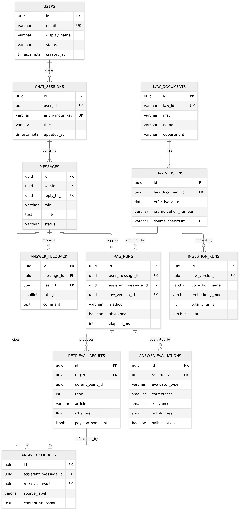
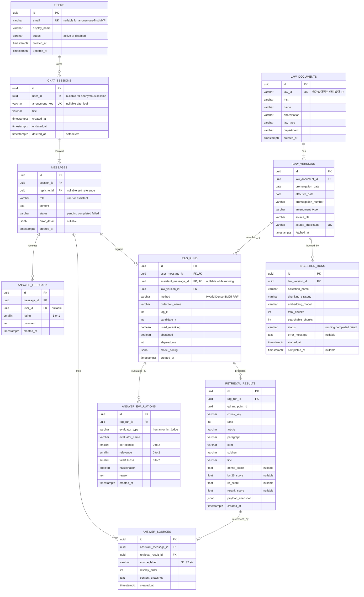

# AI 기본법 RAG PostgreSQL ERD

## 1. 저장소 역할

| 저장소 | 역할 |
|---|---|
| PostgreSQL | 사용자, 대화, 질문·답변, RAG 실행 이력, 검색 결과, 출처, 평가 |
| Qdrant | 법령 청크 payload와 embedding vector 검색 |
| XML 파일 | 국가법령정보센터에서 받은 원본 법령 보관 |

Qdrant의 전체 청크 본문과 벡터를 PostgreSQL에 중복 저장하지 않는다. 대신 답변을 재현할 수 있도록 검색 당시 사용한 Qdrant point ID, 조문 위치, 순위와 점수를 `retrieval_results`에 기록한다.

## 2. ERD



이미지 원본은 [`assets/postgres_erd.mmd`](assets/postgres_erd.mmd)에 있으며, 아래에는 전체 컬럼을 포함한 상세 Mermaid 정의를 함께 유지한다.



## 3. 핵심 관계

1. 사용자 한 명은 여러 대화 세션을 가질 수 있다.
2. 로그인 기능이 없는 현재 단계에서는 `chat_sessions.anonymous_key`로 익명 세션을 식별한다.
3. 한 세션에는 사용자와 Assistant 메시지가 시간순으로 저장된다.
4. 사용자 질문 메시지 하나가 하나의 `rag_runs`를 시작한다.
5. `rag_runs`는 검색 설정, 모델 설정, 실행 시간과 Abstention 여부를 기록한다.
6. 검색된 Top-K 결과는 `retrieval_results`에 순서대로 저장한다.
7. 최종 답변이 실제로 인용한 근거는 `answer_sources`로 분리하여 `[S1]` 표시와 연결한다.
8. 자동 평가와 사람 평가는 `answer_evaluations`에 함께 저장하되 `evaluator_type`으로 구분한다.
9. 법령 원본은 `law_documents`와 `law_versions`로 버전을 분리한다.
10. Qdrant 재색인 이력은 `ingestion_runs`에 기록한다.

## 4. 권장 제약조건

```text
messages.role IN ('user', 'assistant')
messages.status IN ('pending', 'completed', 'failed')
answer_evaluations.correctness BETWEEN 0 AND 2
answer_evaluations.relevance BETWEEN 0 AND 2
answer_evaluations.faithfulness BETWEEN 0 AND 2
answer_feedback.rating IN (-1, 1)
retrieval_results.rank > 0
rag_runs.top_k > 0
```

추가 Unique 제약조건:

```text
UNIQUE (retrieval_results.rag_run_id, retrieval_results.rank)
UNIQUE (answer_sources.assistant_message_id, answer_sources.source_label)
UNIQUE (law_versions.law_document_id, law_versions.effective_date, law_versions.promulgation_number)
```

## 5. 권장 인덱스

```sql
CREATE INDEX ix_chat_sessions_user_updated
    ON chat_sessions (user_id, updated_at DESC)
    WHERE deleted_at IS NULL;

CREATE INDEX ix_messages_session_created
    ON messages (session_id, created_at);

CREATE INDEX ix_rag_runs_created
    ON rag_runs (created_at DESC);

CREATE INDEX ix_retrieval_results_run_rank
    ON retrieval_results (rag_run_id, rank);

CREATE INDEX ix_answer_evaluations_run
    ON answer_evaluations (rag_run_id, evaluator_type);

CREATE INDEX ix_law_versions_document_effective
    ON law_versions (law_document_id, effective_date DESC);
```

## 6. 현재 API와의 연결

현재 `POST /ask` 처리 흐름에 적용하면 다음과 같다.

```text
1. chat_sessions 조회 또는 생성
2. 사용자 질문을 messages에 저장
3. rag_runs를 running 상태로 생성
4. Qdrant Hybrid 검색
5. retrieval_results에 Top-K 저장
6. LLM 답변을 assistant messages에 저장
7. answer_sources에 S1, S2 근거 저장
8. rag_runs 실행 시간과 abstained 상태 갱신
9. 프론트엔드에 answer와 sources 반환
```

## 7. MVP 적용 순서

처음부터 모든 테이블을 구현할 필요는 없다.

### 1단계: 대화 저장

- `chat_sessions`
- `messages`
- `rag_runs`
- `retrieval_results`
- `answer_sources`

### 2단계: 평가와 사용자 반응

- `answer_evaluations`
- `answer_feedback`

### 3단계: 계정과 법령 버전 관리

- `users`
- `law_documents`
- `law_versions`
- `ingestion_runs`

사용자 로그인 기능이 당장 필요하지 않으면 `users` 구현을 미루고 `anonymous_key` 기반 세션부터 시작할 수 있다.
